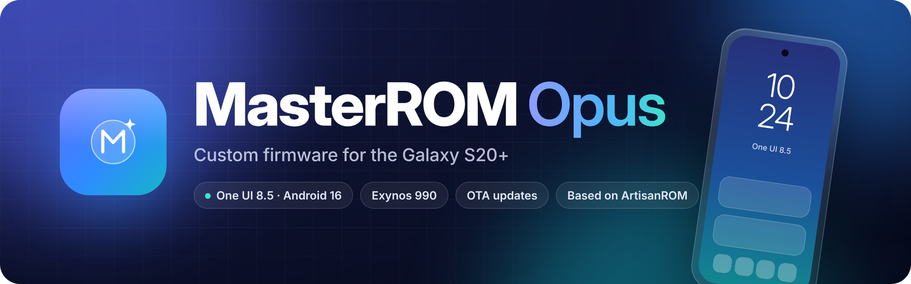

<p align="center">
  
</p>

<p align="center">
  <a href="https://sourceforge.net/projects/masterrom/files/y2s/"></a>
  <a href="https://sourceforge.net/projects/masterrom/files/y2s/"></a>
  
  
  <br>
  <a href="https://github.com/Master37373/MasterROM/blob/sixteen-qpr2/LICENSE"></a>
  <a href="https://github.com/Master37373/MasterROM/commits/sixteen-qpr2"></a>
</p>

<h3 align="center">
  <a href="https://sourceforge.net/projects/masterrom/files/y2s/">⬇️ Download</a>
  &nbsp;·&nbsp;
  <a href="CHANGELOG.md">📝 Changelog</a>
  &nbsp;·&nbsp;
  <a href="https://github.com/Master37373/MasterROM-Updater">📲 Updater</a>
  &nbsp;·&nbsp;
  <a href="https://github.com/Master37373/MasterROM/issues">🐞 Report a bug</a>
</h3>

> [!IMPORTANT]
> **MasterROM is based on [ArtisanROM](https://github.com/ArtisanROM/ArtisanROM) by [Android Artisan](https://github.com/Android-Artisan)**,
> which itself is built on [UN1CA](https://github.com/salvogiangri/UN1CA) by [salvogiangri](https://github.com/salvogiangri).
> Almost everything in this repository – the build system, the device bring-up, the kernel, most patches,
> mods and features – is the work of the ArtisanROM and UN1CA developers and contributors listed below.
>
> MasterROM is **not meant as a kang** and does not claim their work as its own. The new name only makes
> clear that this is a separate build with its own changes, so that bugs in MasterROM are **not** reported
> to ArtisanROM. Fixes from ArtisanROM are taken over regularly.
> If you like the ROM, please support the original projects.

## ✨ At a glance

| | |
|---|---|
| **Device** | Galaxy S20+ (`y2s`, SM-G985F / SM-G986B) |
| **Base** | Galaxy S24+ firmware · One UI 8.5 · Android 16 |
| **Kernel** | ArtisanKRNL with MasterROM patches, KernelSU-Next |
| **Updates** | Over the air with the MasterROM Updater, no root needed |
| **Built on** | [ArtisanROM](https://github.com/ArtisanROM/ArtisanROM) → [UN1CA](https://github.com/salvogiangri/UN1CA) |

## 🧩 What MasterROM adds

<table>
<tr>
<td width="50%" valign="top">

**📲 MasterROM Updater**<br>
Downloads from several mirrors at once, resumes, checks MD5, shows the changelog and installs ROM and kernel updates without root.

</td>
<td width="50%" valign="top">

**💾 SD card as internal storage**<br>
Redesigned SD card page in the One UI glass look, switching between portable and internal storage, protection against formatting from other apps.

</td>
</tr>
<tr>
<td valign="top">

**🗣️ Hi Bixby &amp; Hey Google**<br>
Voice wake-up with the screen off, fixed in the kernel.

</td>
<td valign="top">

**🔋 Battery protection**<br>
Basic, Adaptive and Maximum modes of One UI work on the S20+.

</td>
</tr>
<tr>
<td valign="top">

**🎨 Galaxy S24+ look**<br>
Boot animation, wallpapers and home screen layout of the Galaxy S24+.

</td>
<td valign="top">

**🔒 Encryption fixes**<br>
File-based encryption for the Exynos 990 with hardware inline encryption, factory reset from Settings works with TWRP.

</td>
</tr>
</table>

The full list of changes is in the [changelog](CHANGELOG.md).

## 📦 Installation

1. Unlock the bootloader and install **TWRP**
2. Download the latest zip from [SourceForge](https://sourceforge.net/projects/masterrom/files/y2s/)
3. Flash it in TWRP (or with `adb sideload`)
4. Coming from another ROM: **Format Data**
5. Later updates arrive through the **MasterROM Updater**

> [!NOTE]
> MasterROM is only built and tested for the Galaxy S20+. The other Exynos 990 devices are supported by
> [ArtisanROM](https://github.com/ArtisanROM/ArtisanROM).

## 🛠️ Features from ArtisanROM and UN1CA

<details>
<summary><b>Show all features</b></summary>
<br>

### Core features:
- Based on the latest stable Galaxy S24+ firmware
- EROFS powered
- Galaxy S26 ringtones and sounds, Galaxy S24+ wallpapers
- Galaxy AI support
  - Audio eraser
  - Browsing assist
  - Call assist
  - Drawing assist
  - Interpreter
  - Note assist
  - Now brief
  - Photo assist
  - Semantic search
  - Transcript assist
  - Writing assist
- High end animations
- Native/live blur support
- AOD clock transition support
- Adaptive color tone support
- Adaptive refresh rate support (HFR WIP)
- Extra brightness support
- Picture remaster support
- Object, shadow and reflection eraser support
- Image clipper support
- Multi user support
- Samsung DeX support*
- Camera privacy toggle support
- Debloated from useless system services/additional apps
- Dual Messenger available for all apps
- Custom FlipFont fonts support
- Outdoor mode support
- Auto PIN confirm with 4 digits
- [BluetoothLibraryPatcher](https://github.com/3arthur6/BluetoothLibraryPatcher) integrated
- [KnoxPatch](https://github.com/salvogiangri/KnoxPatch) integrated
- Extra CSC features enabled (Call recording, Hiya, Network speed in status bar, AltZLife)

\* DeX via HDMI not available for devices without USB-C DP support

### From ArtisanROM:
- Integrated OTA updates (now the MasterROM Updater)
- Completely upstreamed kernel (ArtisanKRNL)

### From UN1CA:
- Native/live blur toggle
- One UI Home animations option
- Vulkan renderer toggle
- Key attestation spoof ([TrickyStore](https://github.com/5ec1cff/TrickyStore)) options*
- Play Integrity Fix integrated
- Ability to hide installed apps ([Hide My Applist](https://github.com/Dr-TSNG/Hide-My-Applist))
- Ability to hide developer options
- Allow app downgrade toggle
- Allow installing apps with old targetSdk toggle
- Allow secure screenshot toggle
- Screenshot/screen recording detection toggle
- Games FPS unlock toggle

\* Requires a valid keybox

</details>

## 🏗️ Building

MasterROM is built with the UN1CA build system through GitHub Actions (`.github/workflows/build.yml`).
See the [UN1CA documentation](https://github.com/salvogiangri/UN1CA) for local builds.

## 🙏 Credits

MasterROM is built on the work of everyone who contributed to ArtisanROM and UN1CA:

**ArtisanROM**

<a href="https://github.com/ArtisanROM/ArtisanROM/graphs/contributors"></a>

**UN1CA**

<a href="https://github.com/salvogiangri/UN1CA/graphs/contributors"></a>

<details>
<summary><b>Full credits</b></summary>
<br>

- **[Android Artisan](https://github.com/Android-Artisan)** for creating ArtisanROM and ArtisanKRNL, the base of MasterROM

## Original ArtisanROM credits:
- **[salvogiangri](https://github.com/salvogiangri)** for the UN1CA build system, OneUI patches, and general help and support while developing.
- **[ExtremeXT](https://github.com/ExtremeXT)** for helping fix bugs and giving support.
- **[GhasemzadehFard-Dev](https://github.com/GhasemzadehFard-Dev)** for helping fix many bugs.
- **[Mesazane](https://github.com/Mesazane)** for testing and helping with the updater's design, and for updating and fixing KernelSU-Next on the kernels.
- **[ricci205GTI](https://github.com/ricci205GTI)** for fixing motion photo and help with the x1s.
- **[immohammeeed](https://github.com/immohammeeed)** for creating the website for ArtisanROM.
- **[3q5i](https://github.com/3q5i)** for support and ideas for the ROM.
- **[irvinhaha](https://github.com/irvinhaha)** for designing many banners and logos.
- **[CiprianDinca](https://github.com/CiprianDinca9)** for custom ExtremeROM ringtones.
- **[Dupazlasu/Milxnaq](https://github.com/milxnaq)** for fixing bluetooth on the S10x and much more.
- Everyone else who helped ArtisanROM along the way.

## Original UN1CA credits:
A special thanks goes to the following for their invaluable contributions in no particular order:
- **[ShaDisNX255](https://github.com/ShaDisNX255)** for his help, time and for his [NcX ROM](https://github.com/ShaDisNX255/NcX_Stock) which inspired this project
- **[DavidArsene](https://github.com/DavidArsene)** for his help and time
- **[paulowesll](https://github.com/paulowesll)** for his help and support
- **[Simon1511](https://github.com/Simon1511)** for his support and some of the device-specific patches
- **[ananjaser1211](https://github.com/ananjaser1211)** for troubleshooting and his time
- **[Fede2782](https://github.com/Fede2782)** for his contributions and help with Exynos/MTK support
- **[iDrinkCoffee](https://github.com/iDrinkCoffee-TG)** and **[RisenID](https://github.com/RisenID)** for their support
- **[LineageOS Team](https://www.lineageos.org/)** for their original [OTA updater implementation](https://github.com/LineageOS/android_packages_apps_Updater)
- *All the UN1CA project forks, contributors, testers and users ❤️*

## Also thanks to:
- **[TeamWin](https://twrp.me)** for TWRP and the **KernelSU-Next** developers
- **Samsung** for One UI and the kernel sources, and the **AOSP** project
- Everyone who tests MasterROM and reports bugs

**ArtisanROM Archive**

- [ArtisanROM Archive Org](https://github.com/ArtisanROM-archive)
- [Old Sixteen branch](https://github.com/ArtisanROM-archive/ArtisanROM_old)

</details>

## 📄 Licensing

<details>
<summary><b>GNU General Public License v3.0 and dependencies</b></summary>
<br>

This project keeps the license of ArtisanROM and UN1CA: the [GNU General Public License v3.0](LICENSE).
External dependencies might be distributed under a different license, such as:
- [android-tools](https://github.com/nmeum/android-tools), licensed under the [Apache License 2.0](https://github.com/nmeum/android-tools/blob/master/LICENSE)
- [apktool](https://github.com/iBotPeaches/Apktool), licensed under the [Apache License 2.0](https://github.com/iBotPeaches/Apktool/blob/master/LICENSE.md)
- [erofs-utils](https://github.com/sekaiacg/erofs-utils/), dual license ([GPL-2.0](https://github.com/sekaiacg/erofs-utils/blob/dev/LICENSES/GPL-2.0), [Apache-2.0](https://github.com/sekaiacg/erofs-utils/blob/dev/LICENSES/Apache-2.0))
- [img2sdat](https://github.com/xpirt/img2sdat), licensed under the [MIT License](https://github.com/xpirt/img2sdat/blob/master/LICENSE)
- [platform_build](https://android.googlesource.com/platform/build/) (ext4_utils, f2fs_utils, signapk), licensed under the [Apache License 2.0](https://source.android.com/docs/setup/about/licenses)

</details>

## ⚠️ Disclaimer

```cpp
#include <std_disclaimer.h>

/*
* Your warranty is now void.
*
* I am not responsible for bricked devices, dead SD cards,
* thermonuclear war, or you getting fired because the alarm app failed. Please
* do some research if you have any concerns about doing this to your device
* YOU are choosing to make these modifications, and if
* you point the finger at me for messing up your device, I will laugh at you.
*
* I am also not responsible for you getting in trouble for using any of the
* features in this ROM, including but not limited to Call Recording, secure
* flag removal etc.
*/
```
